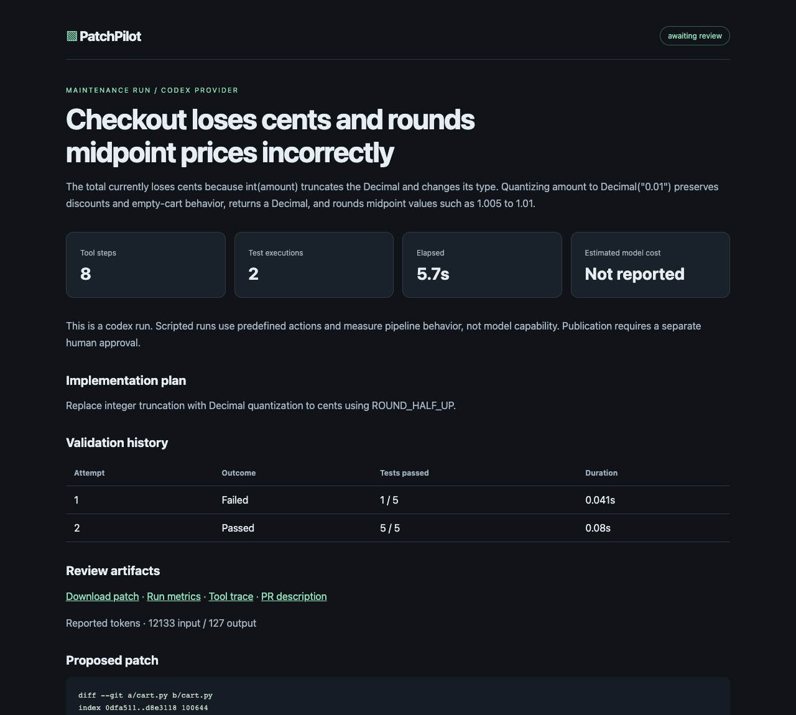

# PatchPilot

[](https://github.com/mohanvamsikrishna-y/patchpilot/actions/workflows/ci.yml)

### Turn an issue into a tested patch, with evidence at every step.

PatchPilot is a software maintenance agent for Python repositories. It inspects a repository, records a plan, edits source code, runs regression tests, and requests human review of a validated patch. A separate command can publish an approved draft pull request.

[Codebase walkthrough](docs/code-guide.md) · [Architecture](docs/architecture.md) · [Demo walkthrough](docs/demo.md) · [Implementation status](docs/status.md)



## Quick start

Requires Python 3.10 or newer and Git. The live demo additionally uses a signed-in Codex CLI. No separate API key is needed for that provider.

```sh
python3 -m patchpilot doctor
python3 -m patchpilot demo --provider codex --open
```

The live model receives the issue, inspected Python files, and actual failing test evidence. It proposes a plan and exact edits as structured JSON. PatchPilot applies those edits through its policy-enforced tools and executes the regression suite. If tests fail, the next proposal receives the failure and refreshed source. The controller allows at most three model repair attempts within the tool and usage budgets.

The terminal shows each step as it completes. The browser report includes the patch, test history, tool trace, measured token usage, and downloadable artifacts. The original demo checkout remains available for review and application.

**Verified live on October 17, 2026**

| Task | Baseline | After model repair | Model proposals |
| --- | --- | --- | --- |
| Checkout Decimal rounding | 1 of 5 tests passes | 5 of 5 pass | 1 |
| Slug whitespace normalization | 1 of 5 tests passes | 5 of 5 pass | 1 |

These are two small seeded tasks, not a general coding benchmark. The model did not receive the scripted action files. Sanitized [checkout evidence](docs/live-runs/checkout/run.json), [slug evidence](docs/live-runs/slug/run.json), and [actual live patch](docs/live-runs/checkout/patch.diff) are included.

```sh
python3 -m patchpilot demo --provider codex --task slug --open
python3 -m patchpilot eval --provider codex
```

Codex uses the configured account's usage allowance. Dollar cost is shown as **Not reported**, because the CLI does not provide invoice cost. Token usage is checked after each model call, so it is not a hard provider-side spending cap. The adapter uses a read-only, ephemeral CLI process with shell, app, plugin, browser, and multi-agent features disabled. It does not delegate file edits or test execution to Codex.

## GitHub issue to draft PR

The full GitHub path is verified with [issue #1](https://github.com/mohanvamsikrishna-y/patchpilot/issues/1) and [generated draft PR #2](https://github.com/mohanvamsikrishna-y/patchpilot/pull/2). PatchPilot read the real issue, obtained a live model repair, ran the unchanged tests, and published the approved patch. The [remote regression check passed](https://github.com/mohanvamsikrishna-y/patchpilot/actions/runs/39361872362). [Saved run evidence](docs/github-run/run.json) includes the baseline, final test counts, usage, and patch hash.

To run the same workflow in your own repository, use a new output folder. This command creates an isolated task branch and GitHub issue, runs live AI repair, and prepares the exact PR publication command for review.

```sh
python3 -m patchpilot github-demo \
  --repo YOUR_ACCOUNT/YOUR_REPO --output runs/github-session --open
```

After inspecting the generated diff and report, run the printed `publish` command to approve and create the draft PR. The task branch contains a minimal Python project and its own PR validation workflow. It does not replace the destination repository's main branch.

[Step-by-step GitHub workflow](docs/github-workflow.md)

## Offline fallback

If the network or model is unavailable during an interview, use the explicitly scripted demo.

```sh
python3 -m patchpilot demo --open
```

This fallback makes real file edits and executes real tests, but uses predetermined actions. It deliberately demonstrates a failed first fix followed by a successful second fix. The report labels the provider as `scripted`.

| Stage | Result |
| --- | --- |
| Baseline checkout implementation | 1 of 5 tests passes |
| First scripted candidate preserves cents | 4 of 5 tests pass |
| Second candidate uses explicit half-up rounding | 5 of 5 tests pass |

```sh
python3 -m patchpilot eval
python3 -m unittest discover -s tests -v
```

[Saved offline evidence](docs/sample-run/run.json) is retained for comparison.

## Apply a reviewed patch locally

```sh
python3 -m patchpilot review --run latest
```

This prints the diff, original target path, and approval hash. Inspect them before applying.

```sh
python3 -m patchpilot apply --run latest \
  --target /path/printed/by/review --approve APPROVAL_SHA256
```

Application requires a clean target at the exact source commit. The approval binds the target path and patch. It leaves an ordinary uncommitted Git diff for inspection and does not push or merge. `latest` resolves through `runs/latest.json`; with a custom output folder, pass the printed run directory instead.

## How it works

```mermaid
flowchart LR
    A[Issue file or GitHub issue] --> B[Clean repository snapshot]
    B --> C[Baseline tests]
    C --> D[Provider proposes tool call]
    D --> E[Schema and policy checks]
    E --> F[Inspect · Plan · Edit]
    F --> G[Fixed test suite]
    G -->|Failure evidence| D
    G -->|Passing current tree| H[Patch and run report]
    H --> I[Human approves publication plan]
    I --> J[Draft GitHub PR]
```



The controller owns the success condition. The model cannot declare a patch valid by saying it is done. The `finish` tool requires a nonempty diff and a passing test run matching the current workspace hash.

One tool registry supports both direct agent execution and an MCP stdio server. Search, file reads, exact replacements, planning, test execution, and review requests use explicit input schemas and structured results.

## What works

| Capability | Evidence and scope |
| --- | --- |
| Repository-aware planning and edits | Read-before-edit policy, recorded plan, exact single-match replacements |
| Iterative repair | Real failed and passing test executions in the checkout fixture |
| MCP tools | Initialization, tool discovery, calls, structured results, protocol error handling |
| Idempotent edits | Same operation ID replays only if arguments and resulting file still match |
| Budgets | Tool step limit, token accounting, conservative request estimates, operator-supplied cost rates |
| Approval gate | Publication plan hash binds repository, base commit, branch, patch, title, and PR body |
| Observability | JSONL tool trace, test history, pass rate, latency, usage, estimated cost, error state |
| Evaluation | Two scripted golden tasks and a regression suite |
| CI | Python 3.10 and 3.12 jobs plus a Docker evaluation job |
| Optional integrations | OpenAI Responses API, GitHub issue intake, approved draft PR publication |

Verified paths include live Codex repair, GitHub issue intake, approved draft PR publication, local patch application, and MCP stdio transport. Python 3.10 and 3.12 regression jobs and Docker evaluation run in GitHub Actions. See [status](docs/status.md) for verification details.

## Run against your own repository

Use a clean Git checkout of a small Python repository with a standard-library `unittest` suite in `tests/`. Existing source files can be edited, but dependencies and test files cannot.

```sh
# Codex provider using an existing login, for trusted local code
python3 -m patchpilot run \
  --provider codex --repo /absolute/path/to/clean/repository \
  --issue /absolute/path/to/issue.md --runner local --trust-local-code --open
```

The alternative direct API provider requires a key and pricing configuration.

```sh
export OPENAI_API_KEY='your-key'
docker build -f Dockerfile.runner -t patchpilot-runner:local .
python3 -m patchpilot run \
  --provider openai \
  --repo /absolute/path/to/clean/repository \
  --issue /absolute/path/to/issue.md \
  --model "$PATCHPILOT_MODEL" \
  --input-rate "$INPUT_USD_PER_MILLION" \
  --output-rate "$OUTPUT_USD_PER_MILLION" \
  --max-cost 1.00
```

Set the model and rates to values for your API account. Rates are deliberately not embedded in code because pricing changes. Estimated cost is not a billing guarantee. Cached-input discounts are ignored. An ambiguous network failure may have unknown billed usage and is not automatically retried.

Live runs default to Docker for **test subprocesses**. The Python controller and its tools run on the host. Build the image first. For code you trust, `--runner local --trust-local-code` explicitly allows host test execution.

`--github-issue https://github.com/OWNER/REPO/issues/NUMBER` can replace `--issue`. It uses an existing GitHub CLI sign-in. Issue text and repository contents are treated as task data, not instructions to change the agent policy.

## Run the complete agent in Docker

`Dockerfile.agent` contains the controller, repository tools, Git, and Python test execution. This command runs the offline repair workflow with a read-only container filesystem and no network, retaining its patch and report on the host.

```sh
docker build -f Dockerfile.agent -t patchpilot-agent:local .
mkdir -p runs/container
docker run --rm --network=none --read-only --tmpfs /tmp \
  --user "$(id -u):$(id -g)" \
  --mount "type=bind,src=$(pwd)/runs/container,dst=/artifacts" \
  patchpilot-agent:local demo --output /artifacts
```

The full image supports the direct API provider when a source checkout and issue file are mounted, an API key is supplied at runtime, and network access is enabled. The signed-in Codex CLI path runs on the host. The separate `Dockerfile.runner` remains available for isolating tests during host-controlled live runs.

## MCP server

```sh
python3 -m patchpilot mcp --repo /absolute/path/to/repository
```

The default server exposes repository reads and GitHub issue reads. `--allow-execution` adds edits and tests. Use that option only with a disposable workspace. Tool outputs use MCP text content and `structuredContent`. The server implements a synchronous subset of protocol version `2025-11-25`, not the full MCP feature set.

[MCP configuration and scope](docs/mcp.md)

## Review and publish

Run this only against the GitHub repository from which the task source originated. The `prepare-demo` and `github-demo` commands can publish a task baseline to an isolated branch for a complete remote workflow.

```sh
python3 -m patchpilot publish-plan --run runs/RUN_ID --repo OWNER/REPO
```

Use `--base BRANCH` on both commands when publishing to a non-default target branch. The approval hash includes that branch. Inspect `publish-plan.json`, `patch.diff`, `pr.md`, and `report.html`. Then pass the plan's `approval_sha256` to authorize a draft PR.

```sh
python3 -m patchpilot publish \
  --run runs/RUN_ID --repo OWNER/REPO --approve APPROVAL_SHA256
```

The model has no publish tool. No automatic merge is implemented. The adapter reuses a deterministic branch and checks for an existing PR when retried. Approval files are local records, not a cryptographic authorization service.

## Project layout

```text
patchpilot/
  agent.py        Controller and run artifacts
  tools.py        Shared schemas and policy-enforced tools
  providers.py    Scripted and OpenAI providers, usage budgets
  codex_provider.py Live JSON proposals through the signed-in Codex CLI
  review.py       Local review plans and approved patch application
  doctor.py       Environment readiness checks
  demo_workspace.py GitHub task setup and complete workflow orchestration
  runtime.py      Repository snapshots and subprocess execution
  mcp.py          MCP stdio adapter
  github.py       Issue intake and approved draft PR publishing
  report.py       Standalone HTML report renderer
  cli.py          Demo, evaluation, live run, and publishing commands
examples/         Two seeded maintenance tasks and scripted actions
tests/            Behavioral regression and protocol tests
docs/             Architecture, evidence, tradeoffs, interview walkthrough
```

## Deliberate limits

This is a single-user prototype for small, trusted Python repositories. Passing existing tests is evidence, not proof that an arbitrary issue is solved. It does not install dependencies, generate tests, support multiple languages, run as a multi-tenant service, or provide a hardened sandbox for adversarial code. Local artifacts may contain source excerpts and test output. Review them before sharing.

The next milestones are broader live-model evaluation against unseen tasks, stronger external validation, full run isolation, durable job state, and broader language support. [Design decisions and tradeoffs](docs/architecture.md) explain the current boundaries.
