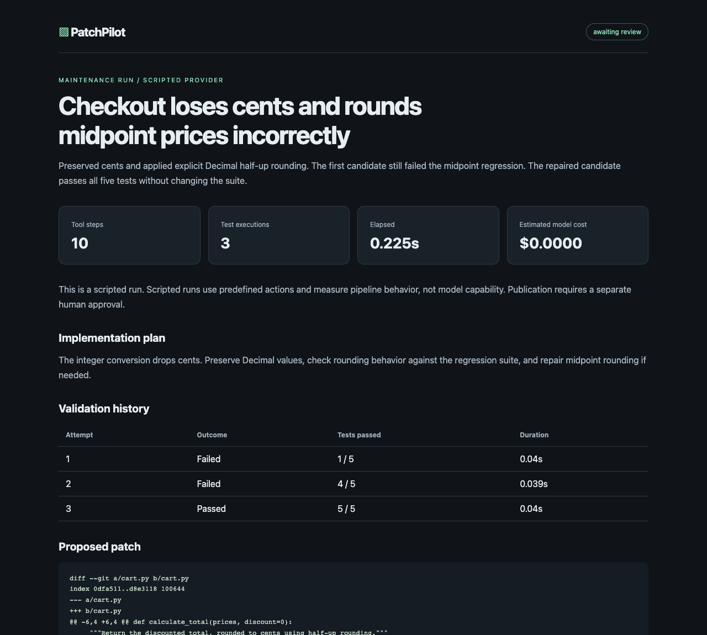

# PatchPilot

### Turn an issue into a tested patch, with evidence at every step.

PatchPilot is a Python software maintenance agent prototype. It inspects a repository, records a plan, edits source code, runs regression tests, and requests human review of a validated patch. A separate command can publish an approved draft pull request.

This repository reconstructs a lost earlier project. It represents the implementation and evidence available today. It does not contain recovered history or imply production deployment.

[Architecture](docs/architecture.md) · [Demo walkthrough](docs/demo.md) · [Implementation status](docs/status.md)



## Run the demo

Requires Python 3.10 or newer and Git. No API key, Docker, package installation, or paid service is needed for the scripted demo.

```sh
python3 -m patchpilot demo
```

Open `report.html` in the printed artifact directory. The same directory contains the unified patch, structured trace, run metrics, and draft PR description.

The checkout demo performs real file edits and executes real tests. Its actions are **scripted**, including the deliberately incomplete first fix. It demonstrates orchestration and regression repair, not a model independently discovering the solution.

| Stage | Result |
| --- | --- |
| Baseline checkout implementation | 1 of 5 tests passes |
| First candidate preserves cents | 4 of 5 tests pass |
| Second candidate uses explicit half-up rounding | 5 of 5 tests pass |
| Final state | Patch awaits human review |

A second fixture repairs whitespace handling in a URL slug utility.

```sh
python3 -m patchpilot demo --task slug
python3 -m patchpilot eval
python3 -m unittest discover -s tests -v
```

[Saved checkout evidence](docs/sample-run/run.json) and [the actual patch](docs/sample-run/patch.diff) are included for review without running the project. The saved [HTML report](docs/sample-run/report.html) can be downloaded and opened locally. GitHub displays its source rather than rendering it.

## How it works

```mermaid
flowchart LR
    A[Issue file or GitHub issue] --> B[Clean repository snapshot]
    B --> C[Baseline tests]
    C --> D[Provider proposes tool call]
    D --> E[Schema and policy checks]
    E --> F[Inspect · Plan · Edit]
    F --> G[Fixed test suite]
    G -->|Failure evidence| D
    G -->|Passing current tree| H[Patch and run report]
    H --> I[Human approves publication plan]
    I --> J[Draft GitHub PR]
```



The controller owns the success condition. The model cannot declare a patch valid by saying it is done. The `finish` tool requires a nonempty diff and a passing test run matching the current workspace hash.

One tool registry supports both direct agent execution and an MCP stdio server. Search, file reads, exact replacements, planning, test execution, and review requests use explicit input schemas and structured results.

## What works

| Capability | Evidence and scope |
| --- | --- |
| Repository-aware planning and edits | Read-before-edit policy, recorded plan, exact single-match replacements |
| Iterative repair | Real failed and passing test executions in the checkout fixture |
| MCP tools | Initialization, tool discovery, calls, structured results, protocol error handling |
| Idempotent edits | Same operation ID replays only if arguments and resulting file still match |
| Budgets | Tool step limit, token accounting, conservative request estimates, operator-supplied cost rates |
| Approval gate | Publication plan hash binds repository, base commit, branch, patch, title, and PR body |
| Observability | JSONL tool trace, test history, pass rate, latency, usage, estimated cost, error state |
| Evaluation | Two scripted golden tasks and a regression suite |
| CI | Python 3.10 and 3.12 jobs plus a Docker evaluation job |
| Optional integrations | OpenAI Responses API, GitHub issue intake, approved draft PR publication |

The optional integrations have mocked contract tests where documented. Live model behavior, remote PR creation, and Docker execution have not been verified in the initial local build. See [status](docs/status.md) for exact limits.

## Live model run

Use a clean Git checkout of a small Python repository with a standard-library `unittest` suite in `tests/`. Existing source files can be edited, but dependencies and test files cannot.

```sh
export OPENAI_API_KEY='your-key'
docker build -f Dockerfile.runner -t patchpilot-runner:local .
python3 -m patchpilot run \
  --repo /absolute/path/to/clean/repository \
  --issue /absolute/path/to/issue.md \
  --model "$PATCHPILOT_MODEL" \
  --input-rate "$INPUT_USD_PER_MILLION" \
  --output-rate "$OUTPUT_USD_PER_MILLION" \
  --max-cost 1.00
```

Set the model and rates to values for your API account. Rates are deliberately not embedded in code because pricing changes. Estimated cost is not a billing guarantee. Cached-input discounts are ignored. An ambiguous network failure may have unknown billed usage and is not automatically retried.

Live runs default to Docker for **test subprocesses**. The Python controller and its tools run on the host. Build the image first. For code you trust, `--runner local --trust-local-code` explicitly allows host test execution.

`--github-issue https://github.com/OWNER/REPO/issues/NUMBER` can replace `--issue`. It uses an existing GitHub CLI sign-in. Issue text and repository contents are treated as task data, not instructions to change the agent policy.

## MCP server

```sh
python3 -m patchpilot mcp --repo /absolute/path/to/repository
```

The default server exposes repository reads and GitHub issue reads. `--allow-execution` adds edits and tests. Use that option only with a disposable workspace. Tool outputs use MCP text content and `structuredContent`. The server implements a synchronous subset of protocol version `2025-11-25`, not the full MCP feature set.

[MCP configuration and scope](docs/mcp.md)

## Review and publish

Run this only against the GitHub repository from which the task source originated. Demo fixtures have local synthetic history and are intended for patch review, not remote publication.

```sh
python3 -m patchpilot publish-plan --run runs/RUN_ID --repo OWNER/REPO
```

Inspect `publish-plan.json`, `patch.diff`, `pr.md`, and `report.html`. Then pass the plan's `approval_sha256` to authorize a draft PR.

```sh
python3 -m patchpilot publish \
  --run runs/RUN_ID --repo OWNER/REPO --approve APPROVAL_SHA256
```

The model has no publish tool. No automatic merge is implemented. The adapter reuses a deterministic branch and checks for an existing PR when retried. Approval files are local records, not a cryptographic authorization service.

## Project layout

```text
patchpilot/
  agent.py        Controller and run artifacts
  tools.py        Shared schemas and policy-enforced tools
  providers.py    Scripted and OpenAI providers, usage budgets
  runtime.py      Repository snapshots and subprocess execution
  mcp.py          MCP stdio adapter
  github.py       Issue intake and approved draft PR publishing
  report.py       Standalone HTML report renderer
  cli.py          Demo, evaluation, live run, and publishing commands
examples/         Two seeded maintenance tasks and scripted actions
tests/            Behavioral regression and protocol tests
docs/             Architecture, evidence, tradeoffs, interview walkthrough
```

## Deliberate limits

This is a single-user prototype for small, trusted Python repositories. Passing existing tests is evidence, not proof that an arbitrary issue is solved. It does not install dependencies, generate tests, support multiple languages, run as a multi-tenant service, or provide a hardened sandbox for adversarial code. Local artifacts may contain source excerpts and test output. Review them before sharing.

The next milestones are live-model evaluation against unseen tasks, stronger external validation, full run isolation, durable job state, and broader language support. [Design decisions and tradeoffs](docs/architecture.md) explain the current boundaries.
