# Architecture and build plan

PatchPilot separates model proposals from trusted execution policy. The initial implementation favors an inspectable vertical slice over a distributed service.

## Build sequence

1. Create a disposable copy of a clean, tracked Git repository.
2. Add a shared schema registry for repository reads, planning, edits, and tests.
3. Implement a bounded controller and a scripted provider for reproducible regression runs.
4. Add the optional Responses API provider using the same tool surface.
5. Expose the tools through MCP stdio.
6. Persist patches, trace events, test metrics, and a standalone review report.
7. Put draft PR publication behind a separate explicit approval command.
8. Add golden tasks, behavioral tests, CI, and a Docker test runner.

These stages are implemented. Verification status is tracked separately in [status.md](status.md).

## Boundaries

```mermaid
sequenceDiagram
    participant U as Operator
    participant C as Controller
    participant P as Provider
    participant T as Tool policy
    participant R as Test runner
    U->>C: Issue and clean repository
    C->>C: Snapshot tracked files
    C->>R: Establish baseline
    loop Within configured budgets
        C->>P: Tool history and observations
        P->>C: One proposed tool call
        C->>T: Validate schema and policy
        T->>T: Inspect, plan, or exact edit
        T->>R: Run fixed suite when requested
        R-->>T: Exit status and test output
        T-->>C: Structured result
        C->>C: Append trace
    end
    C-->>U: Validated patch and review report
    U->>C: Approve exact publication plan
    C-->>U: Draft PR URL
```

## Why a custom controller

The state machine is small enough to inspect directly. A provider supplies tool calls, while the controller owns budgets, trace persistence, and the review transition. This makes the policy surface straightforward to test without requiring a paid model call for every test.

The implementation does not use a vector database. Bounded literal search is sufficient for the small repository scope. Larger repositories would need indexed search, ranked context retrieval, and context budgets per file.

## Why exact replacements

Edits require a prior file read, a nonempty plan, an existing Python source path, and exactly one match. This is deliberately narrower than an unrestricted shell or patch tool. It gives clear failures when the model has stale context. A successful operation ID is remembered in process and can only replay against its recorded resulting file. This is not durable exactly-once execution across crashes.

Tests, workflow files, secret-like paths, and symlinks are excluded from direct edits. A model can still make logically bad source changes. Passing tests plus human review is the current quality gate.

## Validation state

A test run records the workspace hash before execution. Validation succeeds only when the subprocess returns zero, discovers at least one passing test, stays within the timeout, and leaves the tree unchanged. Further edits invalidate the recorded test hash. `finish` checks the current hash again and requires a diff.

The unittest output parser supports this prototype's fixed runner. It is not a trusted remote attestation mechanism. Malicious test code could forge output, alter host resources in local mode, or exploit the container runtime. A stronger design would execute immutable evaluator tests outside the model workspace and collect structured results from a separate trust boundary.

## Isolation

Snapshots preserve tracked regular files and exclude Git internals, common secret paths, and unsupported files. The original checkout is not edited by the agent tools. Snapshots are not a security sandbox.

Docker mode runs test subprocesses with a read-only workspace mount, no network, a non-root user, dropped capabilities, memory and process limits, and a timeout. That runner image does not containerize the full controller. `Dockerfile.agent` separately runs the entire controller and tools inside a container. No Docker socket is mounted into the test container. Dependencies are limited to the runner image's standard library.

Local mode executes Python repository code as the current user. Environment filtering prevents routine API-key inheritance, but it cannot stop hostile code from reading host files. Local mode is for trusted code only.

## Model and cost controls

The live adapter uses OpenAI Responses function calls with strict input schemas and one tool call at a time. It retains response output items, including reasoning items required for subsequent calls. It returns structured tool observations through `function_call_output`.

Each call is preflighted against a conservative byte-based input estimate plus the output cap. Actual reported token usage is recorded. Cost uses operator-provided input and output rates per million tokens. The estimate is not an exact tokenizer calculation, a provider spending limit, or an invoice. Explicit HTTP 429 rejection is retried up to twice. Ambiguous transport failures stop the run to avoid hidden retry charges.

## Publication and approval

The publication plan includes repository, source commit, branch, patch hash, title, body, and draft status. Its hash is the CLI approval token. The model cannot invoke publication. GitHub publication clones the target repository, verifies that the source commit belongs to its default-branch history, applies the patch, pushes a named branch, and opens a draft PR.

Approval protects against accidental changes between review and execution. Someone who can edit the local artifacts can forge them. A production service would need authenticated approvals, immutable artifact storage, signed provenance, and a transactional publication journal.

## Evidence and metrics

`trace.jsonl` stores executed tool calls and observations, not hidden model reasoning. `run.json` stores final status, baseline commit, patch hash, test histories, run latency, token usage, cost estimate, and provider retry count. Errors remain visible in failed run artifacts.

Golden tasks are scripted orchestration tests. Their success rate must not be presented as model accuracy. A useful live benchmark would use unseen issues, independent held-out tests, multiple seeds, per-task cost distributions, and a comparison with a simpler single-shot baseline.

## Primary references

The optional provider follows [OpenAI function calling](https://developers.openai.com/api/docs/guides/function-calling). The MCP adapter follows the [MCP tools specification](https://modelcontextprotocol.io/specification/2025-11-25/server/tools) and [stdio transport specification](https://modelcontextprotocol.io/specification/2025-11-25/basic/transports).

## Live Codex proposal adapter

The Codex provider was added for a live CLI path using an existing CLI sign-in. It discovers up to 20 small Python files through PatchPilot tools, supplies their contents and the baseline to an ephemeral model process, and requests a JSON proposal. Each proposal contains a plan, summary, and one to eight exact replacements. Shell, app, plugin, browser, and multi-agent features are disabled for this process. The CLI runs in an empty temporary working directory with a read-only sandbox.

PatchPilot executes the proposal through the same policy-enforced tool registry used by the direct API provider. A failed candidate triggers fresh reads and another model proposal with failure evidence. Successful tests still require the controller's current-tree validation before review. Model-generated edits are not accepted directly into the user's checkout.

The adapter limits attempts and request duration, preflights a conservative input estimate, and records CLI token usage. Token limits are checked after each request as well. The CLI provides neither an enforceable per-call output-token cap through this adapter nor invoice cost, so the report explicitly marks monetary cost unavailable. It does not claim a hard spend guarantee.

The [Codex noninteractive command reference](https://learn.chatgpt.com/docs/developer-commands#codex-exec) documents JSON events, schema-constrained output, ephemeral sessions, and sandbox options. This adapter was verified with Codex CLI 0.147.0.

## Local application

The `review` command binds a patch hash, source commit, and target path into an approval plan. `apply` rechecks target cleanliness and exact source commit, verifies that Git can apply the patch, then applies it without creating a commit or pushing. A receipt is stored in the run folder. This is a local human review boundary, not authenticated multi-user authorization.

Interrupted, setup-failed, and budget-exhausted runs retain a report and any available trace. Missing or unexecutable baseline tests stop the controller before a model request. Original demo checkouts are retained so the entire review and application workflow can be shown during a call.

## Remote workflow verification

`demo_workspace.prepare` creates a clean task repository with a regression workflow. Explicit flags control whether it pushes the isolated branch and creates a GitHub issue. `execute` composes preparation, issue intake, live repair, and approval-plan generation for the `github-demo` command. It stops before publication so the generated patch can be reviewed.

The publication plan can bind a non-default base branch. The publisher fetches that branch, verifies the tested source commit belongs to its history, applies the patch, and opens a draft PR. PR descriptions include the issue link, plan, baseline and final test counts, provider, run ID, and patch hash. GitHub CLI warnings are kept on stderr so they cannot corrupt JSON responses or saved result URLs.

The integration suite uses an actual local bare Git remote to test branch publication, patch contents, the selected target, and retries after a lost receipt. A separate process acts as an independent MCP stdio client for initialization, tool discovery, and file reading.

## Complete agent container

The full agent image includes Python, Git, the controller, tools, and bundled tasks. Source checkouts can be mounted read-only with a separate writable artifacts mount. CI executes the scripted repair loop entirely inside that image with networking disabled and a read-only container root. A writable temporary filesystem supports short-lived subprocess and Git files.

For live direct-API execution, supply the API key at runtime and allow network access to the model provider. Credentials are not included in the image. The Codex CLI adapter continues to use the host's existing sign-in and can use the separate test-runner image for its tests. These are two execution configurations with explicit boundaries.
